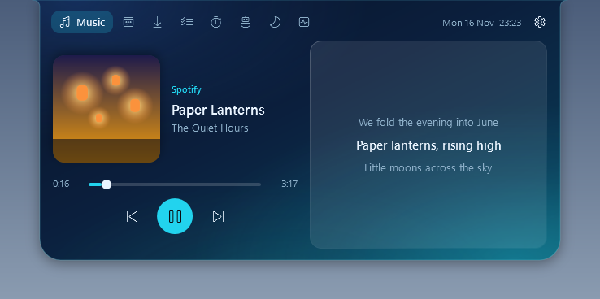
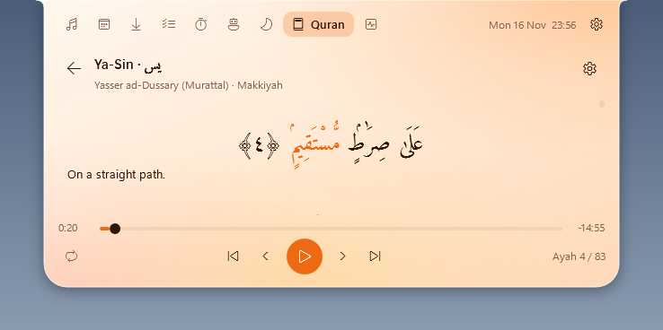
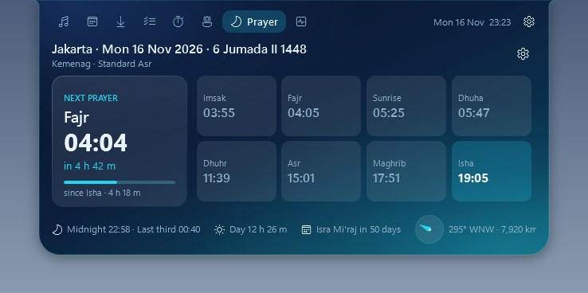
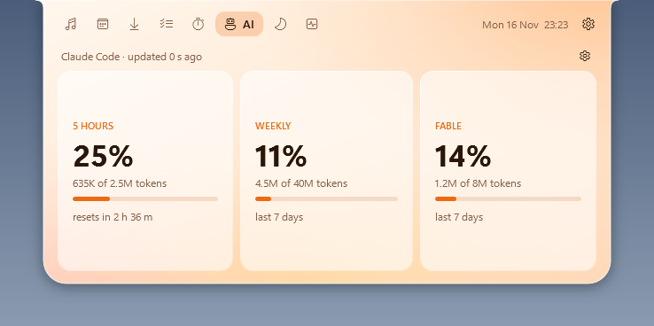

<p align="center"></p>

<h1 align="center">Perch</h1>
<p align="center"><b>A living island for the top of your screen.</b><br>
Windows 10 and 11 · native .NET · no account · nothing leaves your PC except lyrics, Quran and Claude usage lookups</p>

Perch sits at the top centre of your screen as a small pill. While it rests it shows the time, or whatever
matters right now: the song that's playing, your focus timer, the volume as you change it, the charger
going in. Point at it and it springs open into a panel with tabs.

<p align="center">
  
  
</p>
<p align="center">
  
  
</p>

## What it does

| Tab | What you get |
| --- | --- |
| **Music** | Artwork, title and artist for whatever plays in Windows' media controls (Spotify, browsers, Media Player…), play/pause/skip, a seek bar, and time-synced lyrics from LRCLIB. |
| **Today** | The date, how much of the day is gone, and a month calendar you can page through. |
| **Shelf** | Drag files onto the island to keep them here; drag them out again into any app. Text drops become notes. |
| **Tasks** | A small to-do list. Enter to add, click to tick, double-click to edit. |
| **Focus** | A Pomodoro timer with short and long breaks. It keeps counting on the resting island. |
| **AI** | Your Claude plan as progress bars, with the same percentages and reset times as Claude Code's `/usage`: the **5-hour** session, the **weekly** limit and **Fable** (or any per-model limit your plan has), plus token counts from Claude Code's logs. A notice before you run out. Without a Claude Code sign-in it falls back to an estimate from the logs against budgets you set. |
| **Prayer** | Imsak, Fajr, Sunrise, Dhuha, Dhuhr, Asr, Maghrib and Isha for your city, computed on your PC (Kemenag, MWL, ISNA, Umm al-Qura and more). The next prayer with a countdown and progress, the Hijri date, midnight and the last third of the night, day length, the next Islamic date, and the qibla with the distance to the Kaaba. A countdown on the island before each prayer and a gentle chime. |
| **Quran** | Listen to any surah by 14 reciters, including Yasser ad-Dussary, Mishary Alafasy, Sudais and Husary. The Arabic text follows the recitation word by word, with the translation in English, Bahasa Indonesia or both, and optional transliteration. Repeat an ayah or a surah, or carry on to the next. Pauses itself at prayer time. |
| **System** | CPU (with clock speed), GPU and video memory, memory, battery with time left, network speed with totals and IP, disk space and activity, and the busiest apps, each with a live history graph. Sampled only while the tab is open. |

**On the resting island:** the clock, now playing with a little equaliser, the focus countdown, a volume
bar when you press the volume keys, and charging / low-battery notices.

**Looks:** two glass themes, **Tide** (deep navy into cyan) and **Apricot** (warm light orange), with frosted
cards over a softly glowing backdrop, plus plain **Midnight** and **Daylight**. The accent follows the theme or
one of seven colours. Two shapes: *Docked*
(hangs from the top edge with soft shoulders) or *Floating* (a capsule just below the edge). Motion is a
real spring, stepped with the display's frame clock.

**Manners:** hides while a full-screen game, video or presentation is in front; stays out of Alt+Tab and
the taskbar; the empty space around the island is click-through; drawing stops when nothing moves.

## Install

Run `Perch-Setup-1.1.2.exe`. It installs for your user only (no admin prompt) into
`%LOCALAPPDATA%\Programs\Perch`, adds a Start menu entry and, if you leave the box ticked, starts Perch when
you sign in. The app is self-contained: no .NET download needed.

Right-click the tray icon for Settings, Start with Windows and Quit. Uninstall from *Settings › Apps*;
your settings in `%APPDATA%\Perch` are kept for a reinstall (delete the folder to remove them).

## Privacy

Tasks, the Shelf, focus history and settings are plain files in `%APPDATA%\Perch`. There are no accounts,
ads or analytics. The only network requests are the lyrics lookup to `lrclib.net` for the song that is
playing (switch *Lyrics* off in Settings › Music to stop it) and, when you open the Quran tab, the surah text,
translation and recitation from Quran.com (`api.quran.com`, `download.quranicaudio.com`). Surah text you have
opened is kept on your PC. Prayer times are calculated on your PC.

The AI tab asks Anthropic for your plan's usage (`api.anthropic.com`), the same request Claude Code's `/usage`
makes, using the sign-in Claude Code keeps in `%USERPROFILE%\.claude\.credentials.json`. Perch reads only the
access token from that file, sends it only to Anthropic, never stores or logs it and never renews it (when it
expires, Claude Code renews it the next time it runs). From Claude Code's local logs it reads only token counts,
model names and times.

## Build from source

Requires the .NET 8 SDK and (for the installer) Inno Setup 6.

```bash
dotnet build src/Perch/Perch.csproj
dotnet test tests/Perch.Tests
powershell -ExecutionPolicy Bypass -File build/publish.ps1          # tests + self-contained exe + installer in dist/
powershell -ExecutionPolicy Bypass -File build/e2e.ps1 -Installer dist/Perch-Setup-1.1.2.exe
```

`docs/ARCHITECTURE.md` explains how pages and background features plug in.

## Licence

MIT. See `LICENSE.txt`.

The Quran text is shown in [Amiri Quran](https://github.com/aliftype/amiri), embedded under the SIL Open Font
License (`src/Perch/Assets/Fonts/AmiriQuran-OFL.txt`). Recitations, Quran text and translations are fetched
from [Quran.com](https://quran.com) while you use the tab and are not bundled with Perch.
